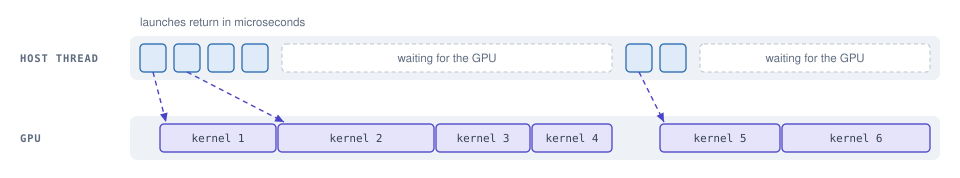
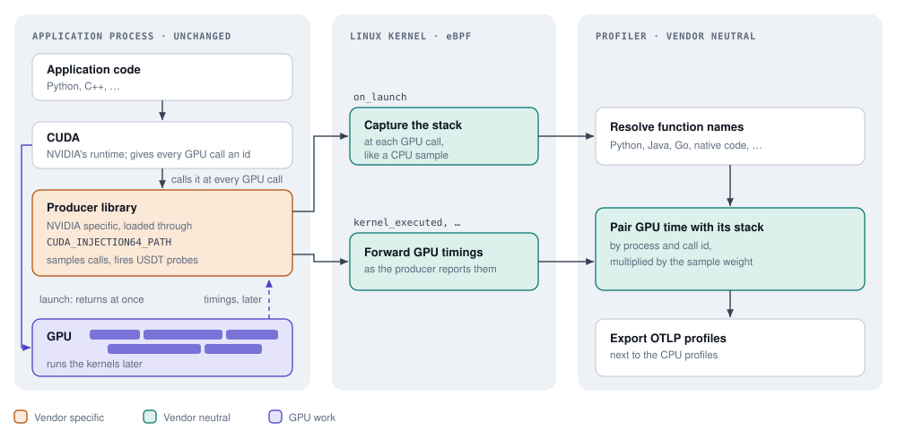
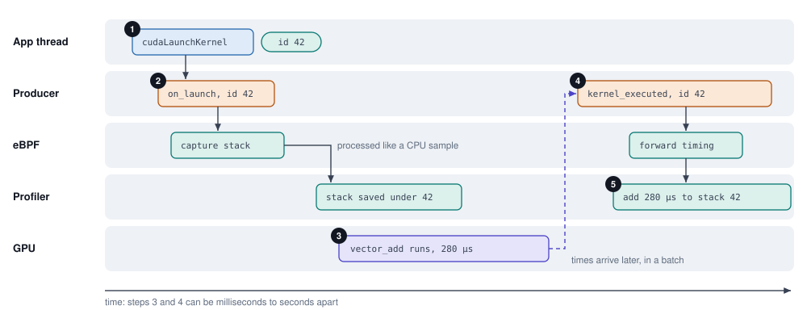
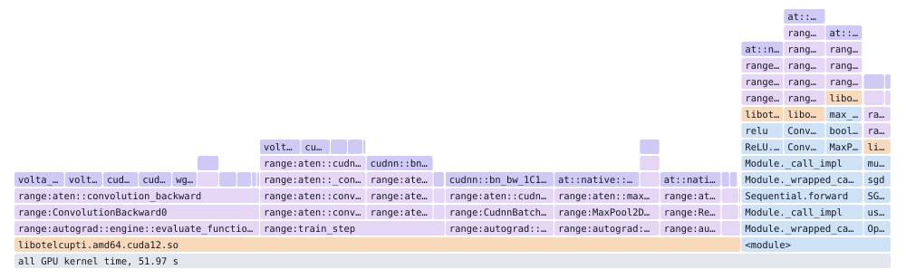

GPU Profiling
=============

# Meta

- **Author(s)**: Mattia Meleleo
- **Start Date**: 2026-10-13
- **Goal End Date**: TBD
- **Primary Reviewers**: [ebpf-profiler-maintainers](https://github.com/orgs/open-telemetry/teams/ebpf-profiler-maintainers)

# Abstract

This document proposes opt-in GPU profiling: GPU time shown under the stack of
the code that caused it, next to CPU time. All vendor specific code lives in a
small library loaded into the application, so the profiler side works for any
GPU vendor.

# Problem

Applications do not run code on the GPU directly. They ask the driver to start a
kernel, and the call returns right away while the kernel runs later. A CPU
profiler therefore sees the application start kernels and wait for them, but not
the GPU time those kernels take.

*A CPU profile of this thread shows six short launches and two waits. The real
cost is the GPU time below, and no stack owns it.*

In machine learning workloads most of the cost is on the GPU, so this is the
question that matters: which line of Python, or which function of a C++ service,
is responsible for the GPU time? GPU utilization metrics only say that the GPU
is busy. Vendor tools such as NVIDIA Nsight answer the question for a developer
running one program on demand, not for always-on profiling of a whole fleet.

The eBPF profiler already captures stacks in many languages, Python included,
from outside the process, and already runs on every host. What it lacks is a way
to learn when a GPU call happens and how long the resulting GPU work took. eBPF
cannot see either: the timing comes from the GPU, and only the vendor's tracing
library reports it.

# Success Criteria

- GPU time shows up under the stack of the code that caused it, in every
  language the profiler supports.
- The feature is opt-in, and its cost on the application and on the profiler
  stays bounded, also at thousands of kernels per second.
- The profiler contains no vendor specific code.
- The profiler's existing stack capture and export are reused, and all new
  memory use is bounded.

## Scope

In scope: the profiler side, and the contract that a library inside the
application must follow.

Out of scope: the libraries themselves; how they get loaded into applications,
for example through an environment variable or a Kubernetes webhook; and
accelerators that cannot report individual GPU calls.

# Proposed Solution

## How it works

The work is split into three parts, and only the first one knows the vendor.

**A library inside the application, the producer.** Applications use NVIDIA
GPUs through CUDA, which loads the library named in the `CUDA_INJECTION64_PATH`
environment variable into every process that uses it, without any change to
the application. The producer uses CUPTI, which calls it on the application's
thread at every GPU call and later hands it the start and end time of every
finished kernel. The producer passes both on through USDT probes, markers
compiled into it that cost nothing until a tool attaches to them, as in the
memory profiling proposal (00003).

**eBPF programs.** The profiler attaches small programs to these probes in each
process. When the application makes a GPU call, they capture the stack, exactly
like a CPU sample. When GPU work finishes, they forward its timing.

**The profiler.** It pairs each piece of finished GPU work with the stack of
the call that started it, adds the GPU time to that stack, and exports the
result with the regular OTLP profiles.

The pairing relies on an id that CUDA gives every GPU call. Following one kernel
through the system:

1. The application launches a kernel. CUDA gives the call an id, say 42.
2. The producer fires the `on_launch` probe with id 42, still on the
   application's thread, and the profiler captures the stack.
3. The kernel runs on the GPU. Later, CUPTI reports its start and end times,
   with id 42.
4. The producer fires the `kernel_executed` probe with id 42 and those times.
5. The profiler finds the stack it saved under id 42 and adds the kernel's time
   to it.

Copies between CPU and GPU memory, memory fills and allocations take the same
path.

GPU timings usually reach the profiler before the stack does, because stacks go
through the same processing as CPU samples. Finished GPU work therefore waits up
to 2 seconds for its stack; if none arrives, the time still counts for the
process, without a stack. All kernels of a CUDA graph share one call id and land
on the same stack. After a process exits, the profiler keeps what it knows about
it for 5 more seconds, for work still in flight. Everything it keeps lives in
maps of fixed size.

## The contract between producer and profiler

The producer and the profiler are built and released separately, so they agree
on a small contract, a C header in this repository:
`probes/gpu/otel_gpu_usdt.h`. Producer authors include it; applications never
see it. All probes are grouped under the name `otel_gpu`, their USDT provider.

| Probe | Fired when |
| --- | --- |
| `ready` | Once, when the producer starts |
| `on_launch` | The application makes a GPU call; fired on its thread |
| `kernel_executed` | A kernel finished on the GPU |
| `gpu_mem` | A memory copy finished |
| `gpu_event` | Other GPU activity, such as memory fills and allocations |
| `error` | The producer cannot profile, for example because another tool already uses CUPTI |

Each probe passes one pointer to a fixed-size record: the call's id, the GPU
start and end times and, where they apply, the kernel name, the bytes copied
and the NVTX ranges active at the call. Names are pointers into the
application's memory, which the profiler reads once per process.

Three rules keep both sides in step:

- The producer reports nothing until the profiler is fully attached. Linux
  raises a counter on a USDT probe while a tool is attached to it; the profiler
  attaches to `ready` last, and the producer waits for that counter. Otherwise,
  work started earlier would report GPU time without a stack.
- The header fixes the CPU register that carries the record pointer, so the
  profiler never has to work out where a compiler put it.
- Incompatible changes get new probe names with a `_v2` suffix, so old and new
  producers keep working with old and new profilers.

Because the profiler only knows this contract, another vendor needs a producer
library, not profiler changes. It takes a way to load a library into unmodified
applications, and a tracing interface that calls it on the thread making each
GPU call with an id that the later timing reports repeat. NVIDIA provides both.

## Keeping the cost down

Capturing a stack costs a few microseconds, about as much as a CPU sample, while
training and inference jobs can launch thousands of kernels per second on one
thread. So the producer samples the calls it reports.

Each thread counts its own calls, separately for kernel launches, CUDA graph
launches, memory operations and allocations. If a thread made N times more calls
of one kind in the last second than the target rate allows, each call is
reported with probability 1/N and counts N times: the producer passes N along as
the call's weight, and the profiler multiplies the GPU time and bytes by it.
Totals stay right on average, and the cost is capped: by default 200 calls per
second per thread and kind, 20 for CUDA graph launches. A call that is not
sampled fires nothing.

On an NVIDIA T4 with these defaults, PyTorch training ran about 2% slower and
ollama inference about 1.5% slower, the profiler used about 0.05 CPU cores, and
all GPU time landed under a stack in both.

## What gets reported

GPU samples are added to each report next to the CPU samples. A sample's stack
starts with the kernel, then the NVTX ranges from the innermost outwards, then
the application stack captured at the call. A new frame type, `gpu`, marks the
frames the profiler adds. GPU samples carry no thread or CPU, since GPU work
runs on neither.

*GPU kernel time of a PyTorch training job on an NVIDIA T4, over 52 seconds.
Kernels are on top, NVTX ranges below them, then the producer and the Python
code that made each call. Frames of native libraries are hidden for
readability.*

Each kind of GPU activity is its own profile, such as `gpu_kernel_time`; the
plan below lists them.

## Limitations

- Only NVIDIA has a producer today.
- Only processes that load the producer are profiled.
- CUPTI serves one tool per process, so the producer cannot run next to another
  tool that uses it, such as NVIDIA Nsight; it reports this through `error`.
- Each stack ends with a few frames of the producer and NVIDIA's libraries,
  between the application code and the GPU frames.

# Plan

The work splits into pull requests that can be reviewed one at a time. Steps 3
to 5 deliver the feature; step 6 lists extras to add only if there is interest.

1. Small, general changes to the profiler, one pull request each:
   - the profiler can check how a USDT probe passes its data before attaching
     to it;
   - profiles can contain frames that the profiler creates itself, starting
     with GPU frames;
   - probes can add their own totals to each report, and keep labeling a
     process's data after it exits;
   - probes can be enabled while the profiler is already processing stacks,
     which today can conflict;
   - probes attach to a process only once the profiler knows its memory
     layout, otherwise the first stacks cannot be read;
   - probes attach without holding the lock that stack processing needs:
     attaching can take seconds, and stopped all stacks in the meantime, CPU
     samples included;
   - stacks captured for probes go through a buffer of their own, so a burst of
     GPU calls cannot crowd out CPU samples.
2. This document.
3. **Stacks of GPU calls.** The `gpu` probe with the contract header: it finds
   the probes in each process, attaches to them and captures the stack at every
   GPU call. The `gpu_launches` profile counts GPU calls per stack. No GPU time
   yet.
4. **GPU time.** Kernel durations, and the duration and size of memory copies
   and fills, paired with the stacks of step 3 and multiplied by the sample
   weights: `gpu_kernel_time`, `gpu_mem_time` and `gpu_mem_bytes`. Producer
   errors are logged. From here on, the profiler answers which code uses the
   GPU.
5. **Model layers.** The producer passes the NVTX ranges active at each GPU
   call, and the profiler adds them as `range:` frames between the kernel and
   the application stack, so a profile shows which part of a model a kernel
   belongs to.
6. **Extras**, one pull request each:
   - GPU memory allocated and freed, per stack and kind of memory:
     `gpu_alloc_bytes`.
   - Unified memory, which the driver moves between CPU and GPU on its own:
     bytes moved and page faults, per process, in `gpu_uvm_bytes` and
     `gpu_uvm_faults`.
   - Stall samples, what running kernels were waiting for, such as memory:
     counted per kernel and reason, per process, in `gpu_stall_samples`.
   - Collective operations, GPUs exchanging data in multi-GPU training, as
     reported by NCCL: time and bytes per operation and process, in
     `gpu_collective_time` and `gpu_collective_bytes`.
   - Time spent in cuDNN and cuBLAS calls, measured with uprobes on their main
     functions: `gpu_api_time`, per process. Opt-in, and needs Linux 5.15.

# Open Questions

- Should `gpu` become a value of `profile.frame.type` in the semantic
  conventions?
- Where should producer libraries live?

# Decision

TBD.

# Glossary

| Term | Meaning |
| --- | --- |
| CUDA | NVIDIA's platform for running work on its GPUs. Applications and frameworks such as PyTorch call its runtime library. |
| CUDA graph | A recorded sequence of kernels that an application replays with a single call, to save the cost of launching each one. |
| cuDNN, cuBLAS | NVIDIA's libraries of neural network and matrix routines, used by most machine learning frameworks. |
| CUPTI | NVIDIA's tracing interface for CUDA. It calls a tool library at every CUDA call, and later reports when the resulting GPU work started and ended. |
| Frame | One function in a stack. Each frame of a profile has a type saying what produced it, such as native code or Python. |
| GPU call | A call into CUDA that starts work on the GPU: launching a kernel, copying or filling memory, or allocating it. |
| Kernel | A small program that runs on the GPU. Applications start thousands of them per second, and each runs for microseconds to milliseconds. Not to be confused with the Linux kernel. |
| NCCL | NVIDIA's library for GPUs exchanging data in multi-GPU training. |
| Nsight | NVIDIA's profiling tools for developers. |
| NVTX range | A named region that a program marks around a piece of its code, such as `train_step`. Ranges can nest. PyTorch can mark every operation it runs, such as `aten::linear`, so the ranges active when a kernel is launched tell which part of a model it belongs to. |
